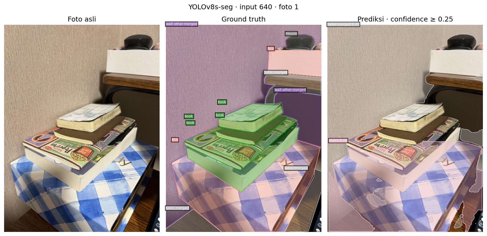
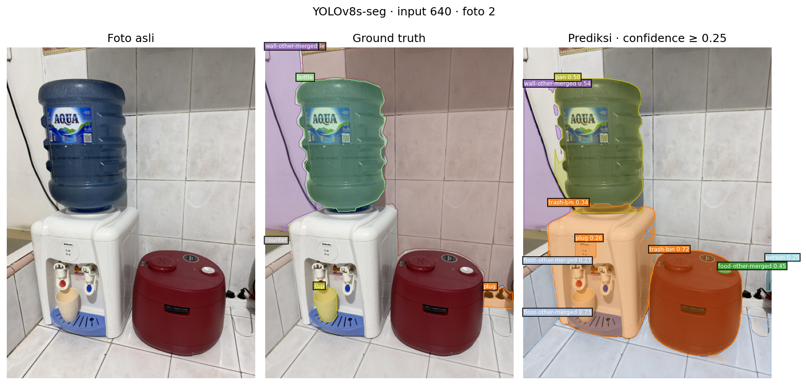
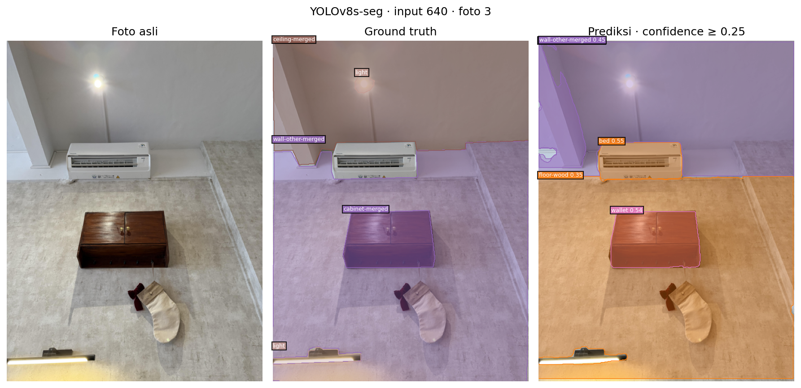
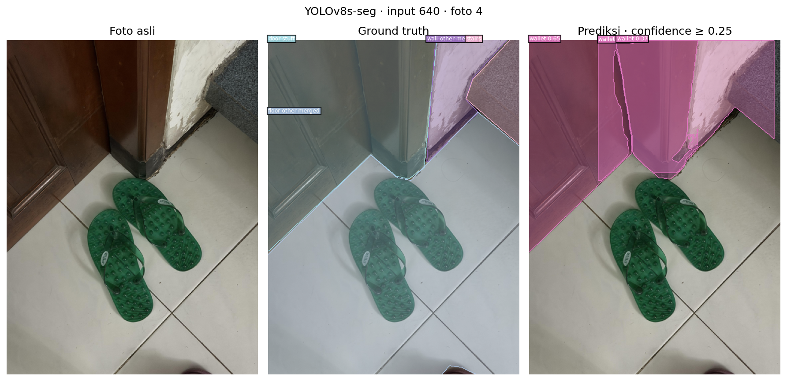
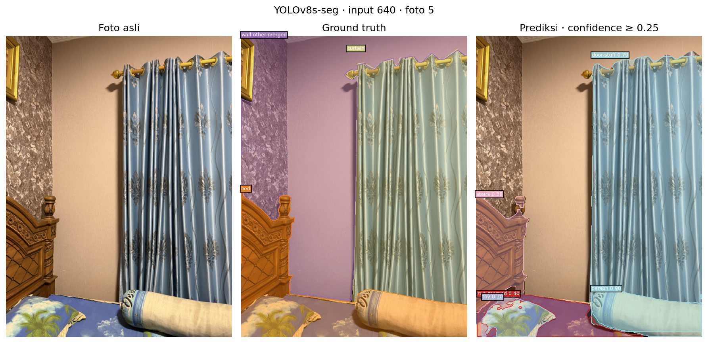

# Analisis Kegagalan pada Lima Foto Pribadi

Analisis ini menggunakan **YOLOv8s-seg dengan input 640** pada lima foto dari test set pribadi. Foto dipilih dari kasus yang gagal pada model tersebut, sehingga hasilnya tidak mewakili rata-rata seluruh 44 foto.

Setiap gambar menampilkan **foto asli di kiri, ground truth di tengah, dan prediksi di kanan**. Ground truth berasal dari anotasi polygon manual di Roboflow. Prediksi pada gambar ditampilkan mulai confidence **0,25**.

## Cara memeriksa kegagalan

Prediksi dianggap benar jika kelasnya sama dengan ground truth dan mask IoU minimal **0,50**. TP adalah prediksi yang cocok, FP adalah prediksi tanpa pasangan, dan FN adalah objek ground truth yang terlewat. Pencocokan dilakukan dari confidence tertinggi, dan satu ground truth hanya boleh mendapat satu pasangan.

Dugaan yang diuji adalah bahwa sebagian objek sebenarnya sudah memiliki prediksi yang sesuai, tetapi tersaring oleh confidence. Untuk memeriksanya, prediksi tersimpan yang sama dibandingkan pada confidence **0,10; 0,25; dan 0,50**. Selain itu, ambang IoU 0,25 dan 0,75 diperiksa sebagai diagnosis bentuk mask. Ambang IoU 0,25 hanya untuk pemeriksaan tambahan dan tidak menggantikan evaluasi COCO utama.

Kode eksperimen ditambahkan ke notebook evaluasi dan dijalankan kembali di Kaggle. Tidak ada training atau inferensi ulang dalam eksperimen threshold ini.

## 1. Tumpukan buku

### Kegagalan yang terlihat

Buku tersusun berlapis dan saling menutupi. Buku tidak dikenali sebagai instance terpisah pada confidence 0,25, sedangkan sebagian area meja diprediksi sebagai `stairs`. Dari 12 objek ground truth, tidak ada yang menjadi TP; terdapat 2 FP dan 12 FN.

### Penjelasan dan pengujian

YOLOv8-seg membentuk mask dari prototype mask dan koefisien tiap deteksi. Detail batas buku yang tipis berpotensi berkurang setelah resize dan pembentukan mask. Namun, saya juga menguji kemungkinan kegagalan akibat confidence rendah, sebelum menyimpulkan bahwa bentuk mask menjadi penyebabnya.

Pada hasil tersimpan, salah satu objek `box` memiliki mask sekelas dengan IoU **0,945** dan score **0,123**. Saat confidence diturunkan ke 0,10, objek tersebut menjadi TP. Hasil berubah menjadi **1 TP, 7 FP, dan 11 FN**.

Artinya, confidence menyebabkan sebagian objek terlewat. Akan tetapi, buku-buku masih belum berhasil dipulihkan pada ambang tersebut. Dugaan hilangnya detail buku akibat resolusi mask belum diuji secara langsung oleh eksperimen ini.

## 2. Dispenser dan galon

### Kegagalan yang terlihat

Galon dan area dispenser diberi kelas yang tidak sesuai, antara lain `pan` dan `trash-bin`. Pada confidence 0,25, terdapat **0 TP, 9 FP, dan 6 FN**. Mask yang tampak menutupi suatu benda belum berarti prediksinya benar karena kelas dan bentuknya juga harus sesuai ground truth.

### Penjelasan dan pengujian

Prediksi kelas dan koefisien mask pada YOLO berasal dari fitur deteksi. Salah kelas dapat membuat segmentasi gagal meskipun sebagian area objek sudah tertangkap. Pada foto ini juga ditemukan prediksi `wall-other-merged` dengan score **0,537**, tetapi mask IoU-nya hanya **0,478** terhadap ground truth.

Menurunkan confidence ke 0,10 tetap menghasilkan **0 TP**, sedangkan FP naik menjadi **20**. Jadi, confidence rendah bukan satu-satunya masalah. Ketika confidence dipertahankan 0,25 dan IoU diagnostik dilonggarkan ke 0,25, satu pasangan menjadi cocok. Ini menunjukkan adanya prediksi dengan kelas yang sesuai tetapi cakupan mask belum memenuhi IoU 0,50.

Hasil mendukung diagnosis gabungan salah kelas dan ketidaksesuaian bentuk mask. Eksperimen ini belum memisahkan pengaruh tekstur latar dari pengaruh fitur model.

## 3. Bagian atas ruangan

### Kegagalan yang terlihat

Area AC diprediksi sebagai `bed` dan kabinet sebagai `wallet`. Lampu juga tidak menghasilkan pasangan mask yang benar pada threshold utama. Terdapat **5 objek ground truth, 0 TP, 5 FP, dan 5 FN**. Area AC yang diberi kelas `bed` menjadi contoh prediksi salah; AC tidak ditambahkan sebagai kelas ground truth baru.

### Penjelasan dan pengujian

Sudut pengambilan dari bawah mengubah tampilan objek, dan lampu menempati area yang relatif kecil. Pada YOLO, resize input dan representasi mask dapat membatasi detail objek kecil. Namun, kesalahan kelas pada kabinet menunjukkan bahwa masalahnya tidak hanya pada batas mask.

Prediksi sekelas `light` dengan overlap terbaik mempunyai IoU sekitar **0,449**, tetapi score hanya **0,015**. Confidence 0,10 belum meloloskan prediksi tersebut dan tetap menghasilkan **0 TP**, dengan FP meningkat menjadi **14**. Pada confidence 0,25, pelonggaran IoU ke 0,25 juga tidak menambah TP.

Dengan demikian, perubahan threshold yang diuji belum memperbaiki kasus ini. Sudut pengambilan dan skala objek merupakan kemungkinan faktor, tetapi perlu eksperimen lain untuk memastikan pengaruhnya.

## 4. Lantai di ambang pintu

### Kegagalan yang terlihat

Area pintu dan dinding diprediksi sebagai `wallet`. Pada confidence 0,25 terdapat **0 TP, 3 FP, dan 4 FN**. Sandal yang terlihat tidak dihitung sebagai objek terlewat karena tidak termasuk anotasi kelas target pada foto ini.

### Penjelasan dan pengujian

Pada segmentasi YOLO, mask yang cukup sesuai masih bisa tidak tampil karena score deteksinya rendah. Saya memeriksa apakah hal itu terjadi pada permukaan lantai.

Ditemukan prediksi kelas `floor-other-merged` dengan IoU **0,716** dan score sekitar **0,1002**. Mask ini cukup sesuai untuk memenuhi IoU 0,50, tetapi tersaring pada confidence 0,25. Saat confidence diturunkan ke 0,10, hasilnya menjadi **1 TP, 7 FP, dan 3 FN**.

Kasus ini mendukung penjelasan bahwa confidence menyebabkan lantai terlewat pada tampilan awal. Namun, jumlah prediksi salah juga bertambah dan objek lain masih belum pulih.

## 5. Tirai dan tempat tidur

### Kegagalan yang terlihat

Tirai diprediksi sebagai `door-stuff`, sedangkan bagian tempat tidur diberi kelas `stairs`. Pada confidence 0,25 terdapat **0 TP, 5 FP, dan 3 FN**.

### Penjelasan dan pengujian

Pada segmentasi instance, mask dan kelas harus sama-sama sesuai. Keluaran mask yang menyerupai area tirai tetap salah jika kelas yang dipilih adalah pintu. Tidak ditemukan kandidat kelas `curtain` pada prediksi tersimpan foto ini, termasuk kandidat dengan confidence rendah yang tersedia mulai sekitar 0,001.

Menurunkan confidence ke 0,10 menghasilkan **1 TP, 8 FP, dan 2 FN**. Akan tetapi, objek yang pulih bukan tirai, karena tidak ada kandidat kelas `curtain` pada prediksi tersebut. Dengan demikian, threshold bukan penjelasan yang cukup untuk kegagalan tirai. Bukti lebih mengarah pada kesalahan pengenalan kelas daripada masalah tepi mask saja.

## Ringkasan eksperimen confidence

Semua angka berikut memakai mask IoU **0,50**. Isi setiap sel adalah **TP / FP / FN**.

| Foto | Confidence 0,10 | Confidence 0,25 | Confidence 0,50 |
| --- | --- | --- | --- |
| 1 | 1 / 7 / 11 | 0 / 2 / 12 | 0 / 0 / 12 |
| 2 | 0 / 20 / 6 | 0 / 9 / 6 | 0 / 4 / 6 |
| 3 | 0 / 14 / 5 | 0 / 5 / 5 | 0 / 3 / 5 |
| 4 | 1 / 7 / 3 | 0 / 3 / 4 | 0 / 2 / 4 |
| 5 | 1 / 8 / 2 | 0 / 5 / 3 | 0 / 2 / 3 |

Dari total 30 objek ground truth pada lima foto:

| Confidence | TP | FP | FN |
| --- | ---: | ---: | ---: |
| 0,10 | 3 | 56 | 27 |
| 0,25 | 0 | 24 | 30 |
| 0,50 | 0 | 11 | 30 |

Confidence 0,10 memulihkan tiga objek, tetapi menghasilkan 56 FP. Confidence 0,50 mengurangi FP menjadi 11, tetapi tidak memulihkan objek ground truth pada kelima foto. Threshold rendah membantu sebagian objek dengan mask yang sesuai, tetapi tidak menyelesaikan salah kelas dan mask yang tidak cocok.

Pada confidence tetap 0,25, pelonggaran IoU menjadi 0,25 hanya menambah satu pasangan pada foto 2. Foto lainnya tetap tidak memiliki TP. Hasil tambahan ini membedakan kasus overlap parsial dari kegagalan yang tidak cukup diperbaiki hanya dengan melonggarkan kesesuaian bentuk.

## Kesimpulan

Kegagalan pada lima foto mencakup objek yang tersaring karena confidence, salah kelas, dan bentuk mask yang belum sesuai. Eksperimen mendukung pengaruh confidence pada sebagian objek, terutama lantai pada foto 4 dan satu box pada foto 1. Pada tirai serta beberapa objek lain, kesalahan tetap ada setelah threshold diturunkan.

Pembahasan resolusi prototype mask merupakan kemungkinan penjelasan arsitektural, bukan penyebab yang sudah dibuktikan secara langsung. Eksperimen ini menguji threshold pada prediksi yang tetap, bukan mengubah arsitektur atau melatih model ulang. AP seluruh test set tetap menggunakan protokol evaluasi awal dan tidak diganti dengan hasil diagnosis lima foto ini.